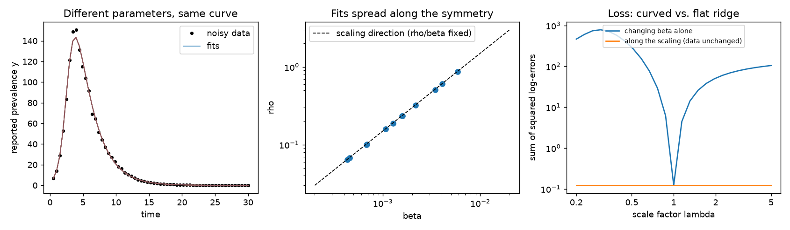

# Identifiability experiment: SIR with unknown reporting fraction

Generated by `python -m nondim experiment`. Synthetic data; truth: beta = 0.002, gamma = 0.4, rho = 0.3, S0 = 990.0, I0 = 10.0.

Observed: `y = rho * I`. The scaling `S, I -> S/λ, I/λ; beta, rho -> λ·beta, λ·rho` leaves `y` unchanged.

## 1. Random-start fits (12 equally good fits)

Fold spread = largest / smallest estimate across fits (1.00 = all fits agree).

| raw parameter | fold spread | | invariant group | fold spread |
|---|---|---|---|---|
| beta | 13.5 | | gamma | 1.000 |
| gamma | 1 | | R0 = beta*S0/gamma | 1.000 |
| rho | 13.5 | | y0 = rho*I0 | 1.000 |
| S0 | 13.5 | | kappa = beta/rho | 1.000 |
| I0 | 13.5 | | | |

The groups are pinned down; the raw parameters moved by the scaling are not.

## 2. Loss along and across the symmetry

Along the scaling direction the loss varies by 2.9e-11 (flat, up to solver error); changing beta alone raises it by up to 783.5.

## 3. Fitting the reduced model under worse data

True R0 = 4.950. `cond` is the condition number of the output-vs-parameter sensitivities, in logs (huge = some direction is undetermined).

| data | points | R0 estimate | R0 rel. error | gamma rel. error | cond (raw, 5 params) | cond (reduced, 4 params) |
|---|---|---|---|---|---|---|
| full data (61 points, 5% noise) | 61 | 5.005 | 1.1% | 0.6% | 2.7e+09 | 4.8e+01 |
| every 4th point | 16 | 4.931 | 0.4% | 0.6% | 2.5e+09 | 3.3e+01 |
| first third only (before the peak) | 20 | 5.222 | 5.5% | 3.8% | 1.1e+09 | 1.5e+01 |
| 20% noise | 61 | 5.179 | 4.6% | 2.2% | 2.7e+09 | 4.8e+01 |

## Reading the results

* The raw model is ill-conditioned in every scenario (in exact arithmetic the condition number is infinite), because one direction is invisible to the data.
* The reduced model is well conditioned, so its estimates degrade gracefully as data get sparser or noisier. That degradation is *practical* non-identifiability (too little information), which is a different thing from the *structural* kind caused by the symmetry.
* Raw parameters were confined to within 100x of the truth; without that box they drift without limit.
* Caveat: scaling symmetries are only one source of non-identifiability (Villaverde & Massonis 2021).
